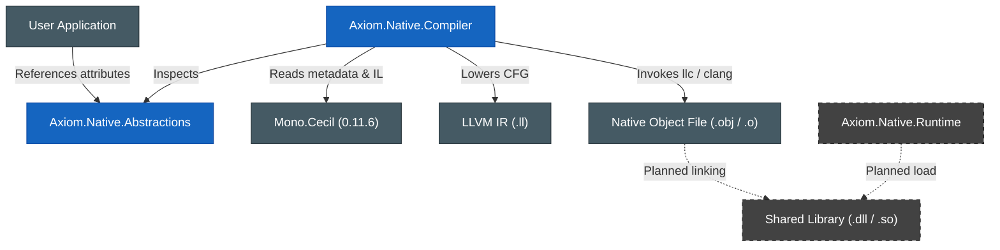
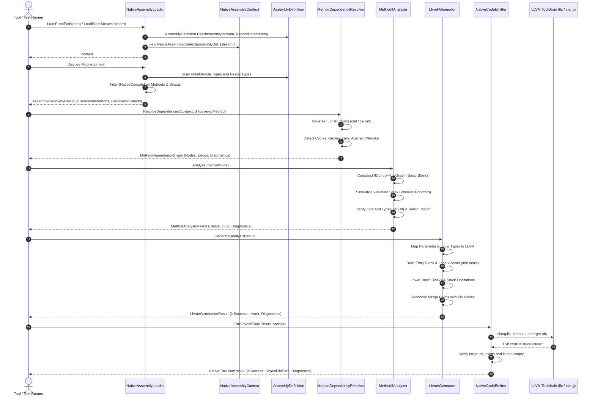

# Axiom.Native Architecture & Design

## 1. Solution Structure

Axiom.Native is organized into three primary functional projects, accompanied by a dedicated test suite and a test assembly fixture:

```
d:\Projects\Axiom\Native\
├── Axiom.Native.slnx                         # Solution file (.NET 10.0, C# 14.0)
├── Directory.Build.props                     # Global build properties (Nullable, LangVersion)
├── Directory.Packages.props                  # Central package management versions
└── projects/
    ├── Axiom.Native.Abstractions/           # Public contracts, attributes, and enums
    │   └── sources/
    │       ├── NativeCompileAttribute.cs     # [NativeCompile] attribute
    │       └── OptimizeFor.cs                # Optimization strategy enum
    ├── Axiom.Native.Compiler/               # Discovery, dependency resolution, IL analysis, and native code emission
    │   └── sources/
    │       ├── Discovery/                    # Milestone 1: Loader and root discovery
    │       ├── Dependencies/                 # Milestone 2: Call graph resolution
    │       ├── Analysis/                     # Milestone 3: IL verification and CFG
    │       ├── CodeGeneration/               # Milestones 4 & 5: LLVM IR & native object emission
    │       │   ├── LlvmIrDiagnostic.cs
    │       │   ├── LlvmIrGenerationResult.cs
    │       │   ├── LlvmIrGenerator.cs
    │       │   ├── LlvmToolchain.cs
    │       │   ├── LlvmTypeHelper.cs
    │       │   ├── NativeCodeEmitter.cs
    │       │   ├── NativeEmissionDiagnostic.cs
    │       │   ├── NativeEmissionOptions.cs
    │       │   └── NativeEmissionResult.cs
    │       └── NativeCompiler.cs             # Compiler facade
    ├── Axiom.Native.Runtime/                # Native loader and invocation bridge (stub)
    │   └── sources/
    │       └── NativeRuntime.cs              # Runtime facade (stub)
    ├── Axiom.Native.Compiler.Tests.TestAssembly/ # Compiled test methods and fixture types
    │   └── sources/
    │       └── SampleTargets.cs              # Realistic test targets
    └── Axiom.Native.Compiler.Tests/         # xUnit unit and integration test suite
        └── sources/
            ├── NativeAssemblyLoaderTests.cs
            ├── MethodDependencyResolverTests.cs
            ├── MethodIlAnalyzerTests.cs
            ├── LlvmIrGeneratorTests.cs
            └── NativeCodeEmitterTests.cs
```

---

## 2. Component Boundaries and Dependencies

To prevent coupling and allow native components to run in lightweight host environments, Axiom.Native enforces strict architectural boundaries:



### Decoupling Rules:
1. **[`Axiom.Native.Abstractions`](file:///d:/Projects/Axiom/Native/projects/Axiom.Native.Abstractions)** has **zero dependencies** outside of the .NET BCL. It can be referenced by any managed project without introducing compiler or runtime overhead.
2. **[`Axiom.Native.Compiler`](file:///d:/Projects/Axiom/Native/projects/Axiom.Native.Compiler)** depends on `Mono.Cecil` (v0.11.6) for metadata inspection and IL analysis. It does **not** reference the runtime host or external native C# binding assemblies. It compiles LLVM IR to native object files using discovered LLVM toolchain utilities (`clang` or `llc`).
3. **[`Axiom.Native.Runtime`](file:///d:/Projects/Axiom/Native/projects/Axiom.Native.Runtime)** must **never depend on LLVM, Mono.Cecil, or Axiom.Native.Compiler**. It is designed as an isolated runtime loader for produced native libraries.

---

## 3. Resource and Assembly Lifetime Management

Mono.Cecil keeps internal streams open unless configured otherwise. Because the compiler frequently runs within IDEs, language servers, or test runners on Windows, keeping file handles open leads to file lock contention (`System.IO.IOException: The process cannot access the file`).

Axiom.Native addresses assembly lifetimes using the following patterns in [`NativeAssemblyLoader`](file:///d:/Projects/Axiom/Native/projects/Axiom.Native.Compiler/sources/Discovery/NativeAssemblyLoader.cs):

1. **In-Memory Reading (`ReadingMode.Immediate`)**:
   Assemblies loaded from disk paths are read into a `MemoryStream` prior to being passed to Cecil, configured with `ReadingMode.Immediate` and `InMemory = true`. The file handle on disk is closed immediately after reading bytes.
2. **Explicit Context Disposal (`NativeAssemblyContext`)**:
   [`NativeAssemblyContext`](file:///d:/Projects/Axiom/Native/projects/Axiom.Native.Compiler/sources/Discovery/NativeAssemblyContext.cs) implements `IDisposable`. Disposing the context disposes the underlying `AssemblyDefinition` and closes all underlying stream resources.

```csharp
// Recommended usage pattern:
using var context = NativeAssemblyLoader.LoadFromPath(assemblyPath);
var roots = NativeAssemblyLoader.DiscoverRoots(context);

// Process roots...
```

---

## 4. Processing Pipeline Sequence

The sequence diagram below traces how a target method moves from discovery through IL analysis, LLVM IR generation, and native code emission:



---

## 5. Next Steps

- For public attribute semantics, see [Public API & Attributes](public-api.md).
- For assembly scanning and struct support, see [Discovery Subsystem](compiler/discovery.md).
- For call graph traversal, see [Dependency Resolution Subsystem](compiler/dependencies.md).
- For control flow and stack validation, see [IL Analysis Subsystem](compiler/il-analysis.md).
- For LLVM IR lowering, see [LLVM IR Generation Subsystem](compiler/llvm-ir-generation.md).
- For native object file compilation, see [Native Code Emission Subsystem](compiler/native-code-emission.md).
