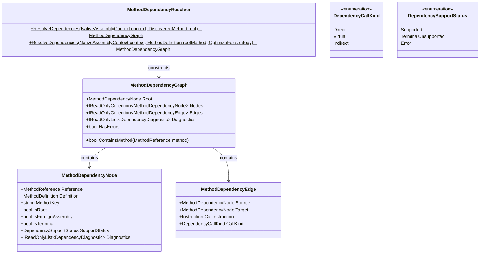

# Compiler Subsystem: Dependency Resolution

The Dependency Resolution subsystem constitutes **Milestone 2** of Axiom.Native. Once compilation roots are discovered, this subsystem inspects their intermediate language (IL) to build a complete, transitive call graph of all invoked methods.

---

## 1. Core Classes & Models

The subsystem resides in `Axiom.Native.Compiler.Dependencies`:



---

## 2. Graph Construction Algorithm

[`MethodDependencyResolver`](file:///d:/Projects/Axiom/Native/projects/Axiom.Native.Compiler/sources/Dependencies/MethodDependencyResolver.cs) analyzes dependencies using an iterative worklist algorithm:

1. **Root Initialization**:
   The attributed method is created as the root node (`IsRoot = true`) and added to the processing queue.
2. **IL Instruction Traversal**:
   For each method in the worklist that has an IL body (`MethodDefinition.HasBody == true`):
   - Scans all instructions searching for call opcodes: `OpCodes.Call` and `OpCodes.Callvirt`.
   - Extracts the operand as a `MethodReference`.
3. **Reference Resolution**:
   - Resolves the `MethodReference` to a `MethodDefinition` via Cecil's `Resolve()`.
   - If resolution fails, emits diagnostic `AXM1001` and marks the node as `DependencySupportStatus.Error`.
4. **Call Kind Classification**:
   - `OpCodes.Call` is classified as `DependencyCallKind.Direct`.
   - `OpCodes.Callvirt` is classified as `DependencyCallKind.Virtual`.
5. **Cycle Detection & Deduplication**:
   - Nodes are tracked by a deterministic composite method key (`MethodKey = MethodReference.FullName`).
   - If a method has already been visited or is in progress, the edge is recorded to represent recursion, but the method is not re-enqueued.

---

## 3. Boundary & Compatibility Analysis

Not all C# methods can be natively compiled or traced. The resolver evaluates method compatibility and marks nodes as `TerminalUnsupported` or `Error`:

| Condition | Diagnostic Code | Support Status | Rationale |
|---|:---:|:---:|---|
| Reference Resolution Failure | `AXM1001` | `Error` | Assembly or type reference missing from assembly resolver. |
| Abstract Method | `AXM1002` | `TerminalUnsupported` | Cannot be compiled without an implementation body. |
| P/Invoke Method | `AXM1003` | `TerminalUnsupported` | Native interop stub; already native, not compilable via IL lowering. |
| CLR InternalCall | `AXM1004` | `TerminalUnsupported` | Runtime internal VM implementation (e.g., GC/reflection intrinsic). |
| Missing IL Body | `AXM1005` | `TerminalUnsupported` | Runtime-implemented or external method without CIL body. |
| Generic Method or Type | `AXM1006` | `TerminalUnsupported` | Generic specialization requires runtime instantiation or monomorphization. |
| Virtual / Interface Dispatch | `AXM1007` | `TerminalUnsupported` | Requires runtime vtable/interface dispatch mechanism. |

### Foreign Assembly Boundaries
If a resolved method belongs to an assembly other than the root assembly (e.g., `System.Runtime`, `System.Private.CoreLib`):
- `IsForeignAssembly = true`
- `IsTerminal = true`
- The method is treated as an external boundary; its internal body is not traversed further.

---

## 4. Usage Example

```csharp
using Axiom.Native.Compiler.Discovery;
using Axiom.Native.Compiler.Dependencies;

using var context = NativeAssemblyLoader.LoadFromPath("MyMathLibrary.dll");
var discovery = NativeAssemblyLoader.DiscoverRoots(context);

var rootMethod = discovery.Methods[0];
var graph = MethodDependencyResolver.ResolveDependencies(context, rootMethod);

Console.WriteLine($"Total Nodes: {graph.Nodes.Count}, Total Edges: {graph.Edges.Count}");
Console.WriteLine($"Has Errors: {graph.HasErrors}");

foreach (var edge in graph.Edges)
{
    Console.WriteLine($"{edge.Source.MethodKey} -[{edge.CallKind}]-> {edge.Target.MethodKey}");
}
```

