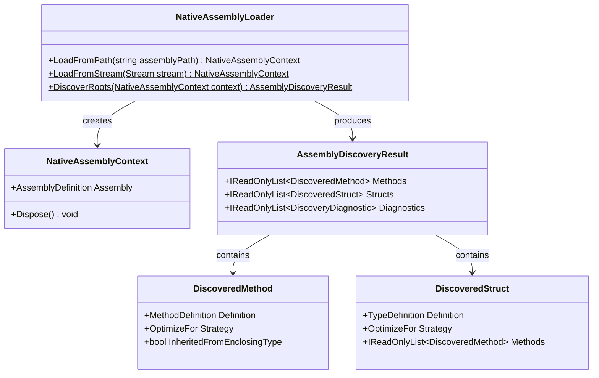

# Compiler Subsystem: Assembly & Root Discovery

The Discovery subsystem constitutes **Milestone 1** of Axiom.Native. It is responsible for loading managed assemblies via Mono.Cecil and identifying all methods and structures targeted for native compilation.

---

## 1. Core Classes & Models

The Discovery subsystem resides in the `Axiom.Native.Compiler` assembly under the namespace `Axiom.Native.Compiler.Discovery`:



---

## 2. Assembly Loading & Lifetime Management

### `NativeAssemblyLoader`
[`NativeAssemblyLoader`](file:///d:/Projects/Axiom/Native/projects/Axiom.Native.Compiler/sources/Discovery/NativeAssemblyLoader.cs) provides factory methods for loading assemblies:

- `LoadFromPath(string assemblyPath)`:
  Reads all file bytes into a `MemoryStream` and passes it to Cecil with `ReadingMode.Immediate` and `InMemory = true`. This prevents Windows file-locking issues, enabling subsequent build or clean operations on the assembly.
- `LoadFromStream(Stream stream)`:
  Accepts an existing readable, seekable stream and constructs a Cecil `AssemblyDefinition`.

### `NativeAssemblyContext`
[`NativeAssemblyContext`](file:///d:/Projects/Axiom/Native/projects/Axiom.Native.Compiler/sources/Discovery/NativeAssemblyContext.cs) encapsulates the Cecil `AssemblyDefinition` and manages its lifetime:
- Implements `IDisposable`.
- Upon disposal, disposes `AssemblyDefinition` and any internally created streams.

---

## 3. Root Discovery Algorithm

[`NativeAssemblyLoader.DiscoverRoots`](file:///d:/Projects/Axiom/Native/projects/Axiom.Native.Compiler/sources/Discovery/NativeAssemblyLoader.cs) scans the main module of the assembly using the following pipeline:

1. **Top-Level and Nested Types Scanning**:
   Traverses all types in `context.Assembly.MainModule.Types`, recursively descending through `TypeDefinition.NestedTypes`.
2. **Struct Inspection**:
   - If a type is a value type (`IsValueType == true` and not an enum) and carries `[NativeCompile]`:
     - Reads the `OptimizeFor` argument (defaults to `OptimizeFor.ExecutionSpeed`).
     - Gathers all instance and static methods declared within the struct.
     - Creates a [`DiscoveredStruct`](file:///d:/Projects/Axiom/Native/projects/Axiom.Native.Compiler/sources/Discovery/DiscoveredStruct.cs).
     - Each method inside the struct is marked as `InheritedFromEnclosingType = true`, inheriting the struct's `OptimizeFor` setting unless overridden.
3. **Method Inspection & Overrides**:
   - Inspects every method in the type for direct `[NativeCompile]` attribution.
   - If a method already acquired an inherited strategy from its enclosing struct:
     - The explicit method-level attribute overrides `OptimizeFor`.
     - `InheritedFromEnclosingType` is set to `false`.
   - If a method has no enclosing struct attribution, it is registered as an independent root [`DiscoveredMethod`](file:///d:/Projects/Axiom/Native/projects/Axiom.Native.Compiler/sources/Discovery/DiscoveredMethod.cs).

---

## 4. Attribute Extraction Details

The loader matches `[NativeCompile]` using Cecil attribute metadata:
- Attribute type full name must equal `Axiom.Native.NativeCompileAttribute`.
- If constructor arguments are supplied, the first argument is mapped to `OptimizeFor`.
- If named properties are supplied, `OptimizeFor` is extracted from named property arguments.
- If no argument is provided, the strategy defaults to `OptimizeFor.ExecutionSpeed`.

---

## 5. Usage Example

```csharp
using Axiom.Native.Compiler.Discovery;

// 1. Load assembly into memory without file locking
using var context = NativeAssemblyLoader.LoadFromPath("path/to/MyMathLibrary.dll");

// 2. Discover compilation roots
var result = NativeAssemblyLoader.DiscoverRoots(context);

// 3. Inspect discovered roots
foreach (var method in result.Methods)
{
    Console.WriteLine($"Method Root: {method.Definition.FullName} ({method.Strategy})");
}

foreach (var str in result.Structs)
{
    Console.WriteLine($"Struct Root: {str.Definition.FullName} ({str.Strategy}) with {str.Methods.Count} methods");
}
```

