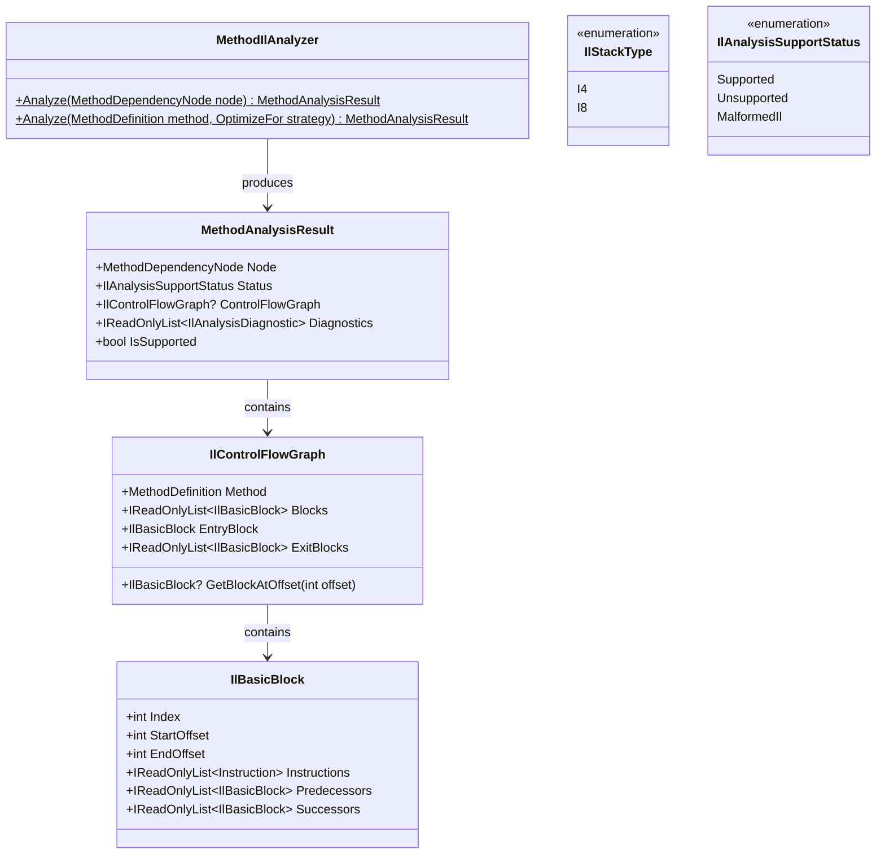
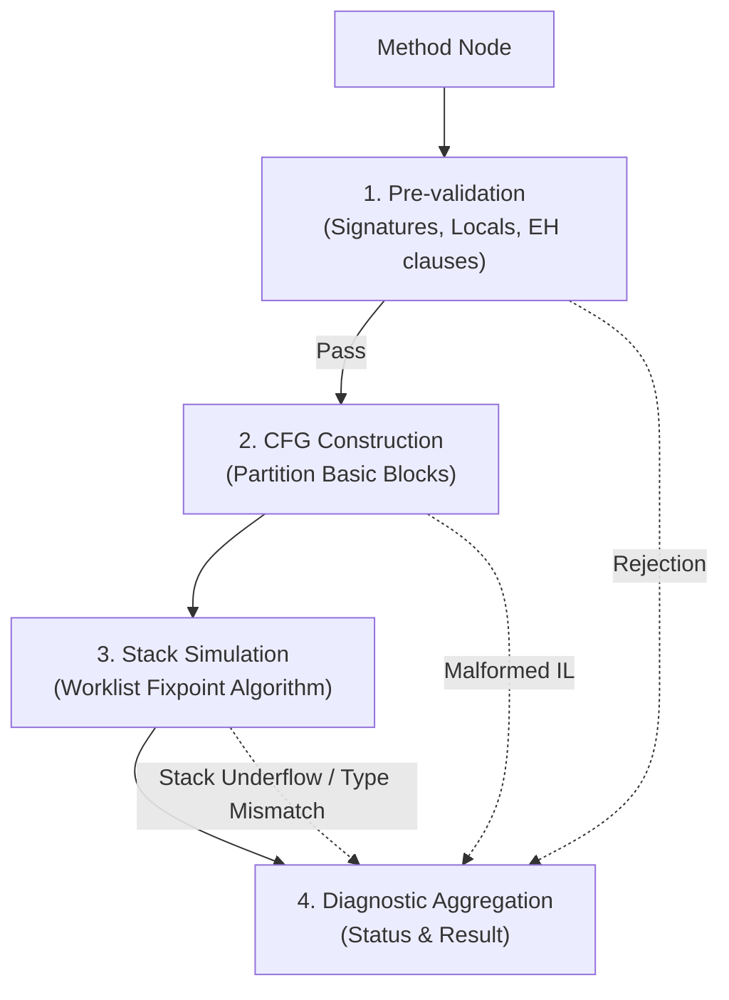

# Compiler Subsystem: IL Analysis & Validation

The IL Analysis subsystem constitutes **Milestone 3** of Axiom.Native. It performs ahead-of-time verification on the Common Intermediate Language (CIL) bytecode of target methods, ensuring they strictly adhere to the supported primitive subset prior to native lowering.

---

## 1. Core Classes & Models

The subsystem resides in `Axiom.Native.Compiler.Analysis`:



---

## 2. Analysis Pipeline

[`MethodIlAnalyzer`](file:///d:/Projects/Axiom/Native/projects/Axiom.Native.Compiler/sources/Analysis/MethodIlAnalyzer.cs) analyzes a method through four rigorous phases:



### Phase 1: Pre-Validation
Before executing abstract interpretation:
1. **Body Presence**: The method must possess an IL body (`MethodDefinition.HasBody == true`). Methods without bodies fail with `AXM2010`.
2. **Generics Exclusion**: Generic methods or methods in generic types are rejected with `AXM2002`.
3. **Exception Handling Exclusion**: Methods containing exception handling clauses (`try`, `catch`, `finally`, `fault`, `filter`) are rejected with `AXM2003`.
4. **Signature Type Verification**:
   - Parameter types, local variable types, and the return type must be supported primitive types:
     - `bool`, `byte`, `sbyte`, `short`, `ushort`, `int`, `uint`, `long`, `ulong`, `char`, `void`.
   - Any reference types (e.g., `string`, classes), arrays, pointers, user structs, or floating-point types (`float`, `double`) trigger `AXM2002`.
5. **Instance Method & `this` Access**:
   - For instance methods, parameter 0 represents `this`.
   - Access to `this` (e.g. `ldarg.0`) is rejected with `AXM2002` as non-primitive reference/pointer access.

### Phase 2: Control Flow Graph (CFG) Construction
1. Identifies **basic block boundaries**:
   - The method entry instruction (offset 0).
   - Any instruction targeted by a conditional or unconditional branch.
   - Any instruction immediately following a branch or `ret`.
2. Assembles instructions into non-overlapping [`IlBasicBlock`](file:///d:/Projects/Axiom/Native/projects/Axiom.Native.Compiler/sources/Analysis/IlBasicBlock.cs) instances.
3. Computes predecessor and successor links, validating that branch targets do not point outside method boundaries (`AXM2007`).

### Phase 3: Abstract Stack Simulation (Worklist Algorithm)
To guarantee type safety and stack balance across loops and conditional jumps, the analyzer runs a fixpoint worklist algorithm:
- Tracks incoming and outgoing abstract stacks per basic block.
- Abstract stack elements are modeled as [`IlStackType`](file:///d:/Projects/Axiom/Native/projects/Axiom.Native.Compiler/sources/Analysis/IlStackType.cs):
  - `I4`: 32-bit integer, boolean, char, short, byte, and uint primitives.
  - `I8`: 64-bit integer and ulong primitives.
- **Merge Point Convergence**:
  - When control flow converges at a basic block, the incoming stack height and stack types **must exactly match** previously evaluated predecessor states.
  - Any height discrepancy or type clash emits `AXM2006` (`MalformedIl`).
- **Return Verification**:
  - A `ret` instruction requires:
    - For `void` methods: exactly an empty evaluation stack.
    - For non-void methods: exactly one item matching the declared return type (`I4` or `I8`).
    - Non-empty stack on void return or extra items on value return emits `AXM2008`.

---

## 3. Supported vs. Unsupported IL Instructions

The analyzer categorizes instructions strictly:

| Category | Supported IL Instructions | Stack Impact |
|---|---|---|
| **Constants** | `nop`<br/>`ldc.i4.m1`, `ldc.i4.0`..`ldc.i4.8`<br/>`ldc.i4.s`, `ldc.i4`<br/>`ldc.i8` | Pushes `I4` or `I8`. |
| **Arguments** | `ldarg.0`..`ldarg.3`, `ldarg.s`, `ldarg` | Pushes parameter's `IlStackType`.<br/>*(Access to `this` rejected).* |
| **Locals** | `ldloc.0`..`ldloc.3`, `ldloc.s`, `ldloc`<br/>`stloc.0`..`stloc.3`, `stloc.s`, `stloc` | Loads push local's type.<br/>Stores pop matching type. |
| **Stack Ops** | `dup`, `pop` | `dup`: duplicates top element.<br/>`pop`: discards top element. |
| **Arithmetic** | `add`, `sub`, `mul`, `div`, `div.un`, `rem`, `rem.un`<br/>`neg` | Binary: pops 2 operands (`I4` & `I4` $\to$ `I4`; `I8` & `I8` $\to$ `I8`).<br/>Unary: pops 1, pushes same type. |
| **Bitwise** | `and`, `or`, `xor`, `not`<br/>`shl`, `shr`, `shr.un` | Binary bitwise: requires matching types.<br/>Shifts: value (`I4`/`I8`), shift count (`I4`). |
| **Conversions** | `conv.i4`, `conv.u4`<br/>`conv.i8`, `conv.u8` | Pops `I4`/`I8`, pushes converted type. |
| **Comparisons** | `ceq`, `cgt`, `cgt.un`, `clt`, `clt.un` | Pops 2 operands of same type, pushes `I4`. |
| **Branches** | `br`, `br.s`<br/>`brtrue`, `brtrue.s`, `brfalse`, `brfalse.s`<br/>`beq`, `beq.s`, `bne.un`, `bne.un.s`<br/>`bge`, `bge.s`, `bge.un`, `bge.un.s`<br/>`bgt`, `bgt.s`, `bgt.un`, `bgt.un.s`<br/>`ble`, `ble.s`, `ble.un`, `ble.un.s`<br/>`blt`, `blt.s`, `blt.un`, `blt.un.s` | Unconditional: stack unchanged.<br/>Unary cond: pops 1 `I4`.<br/>Binary cond: pops 2 matching operands. |
| **Control** | `ret` | Verified against return type. |

### Explicitly Unsupported Instructions
The following instruction families trigger diagnostic errors:
- **Argument Mutator**: `starg`, `starg.s` $\to$ `AXM2001`.
- **Method Invocations**: `call`, `callvirt`, `calli`, `newobj` $\to$ `AXM2011`.
- **Heap & Object Allocation**: `newarr`, `initobj`, `box`, `unbox`, `ldstr` $\to$ `AXM2001`.
- **Fields & Arrays**: `ldfld`, `stfld`, `ldsfld`, `stsfld`, `ldelem.*`, `stelem.*` $\to$ `AXM2001`.
- **Floating-Point Arithmetic**: `ldc.r4`, `ldc.r8`, `add` on floats $\to$ `AXM2001` / `AXM2002`.
- **Exception Handling**: `throw`, `rethrow`, `leave`, `leave.s`, `endfinally` $\to$ `AXM2001` / `AXM2003`.
- **Indirect & Address Operators**: `ldloca`, `ldarga`, `ldind.*`, `stind.*`, `localloc` $\to$ `AXM2001`.

---

## 4. Usage Example

```csharp
using Axiom.Native.Compiler.Discovery;
using Axiom.Native.Compiler.Dependencies;
using Axiom.Native.Compiler.Analysis;

using var context = NativeAssemblyLoader.LoadFromPath("MyMathLibrary.dll");
var discovery = NativeAssemblyLoader.DiscoverRoots(context);

var rootMethod = discovery.Methods[0];
var graph = MethodDependencyResolver.ResolveDependencies(context, rootMethod);

// Run IL Analysis on the root node
var analysisResult = MethodIlAnalyzer.Analyze(graph.Root);

if (analysisResult.IsSupported)
{
    Console.WriteLine($"Method {graph.Root.MethodKey} is eligible for LLVM lowering!");
    Console.WriteLine($"Basic blocks: {analysisResult.ControlFlowGraph!.Blocks.Count}");
}
else
{
    Console.WriteLine($"Method rejected ({analysisResult.Status}):");
    foreach (var diag in analysisResult.Diagnostics)
    {
        Console.WriteLine($" - [{diag.Code}] {diag.Message} (IL offset: {diag.InstructionOffset})");
    }
}
```

