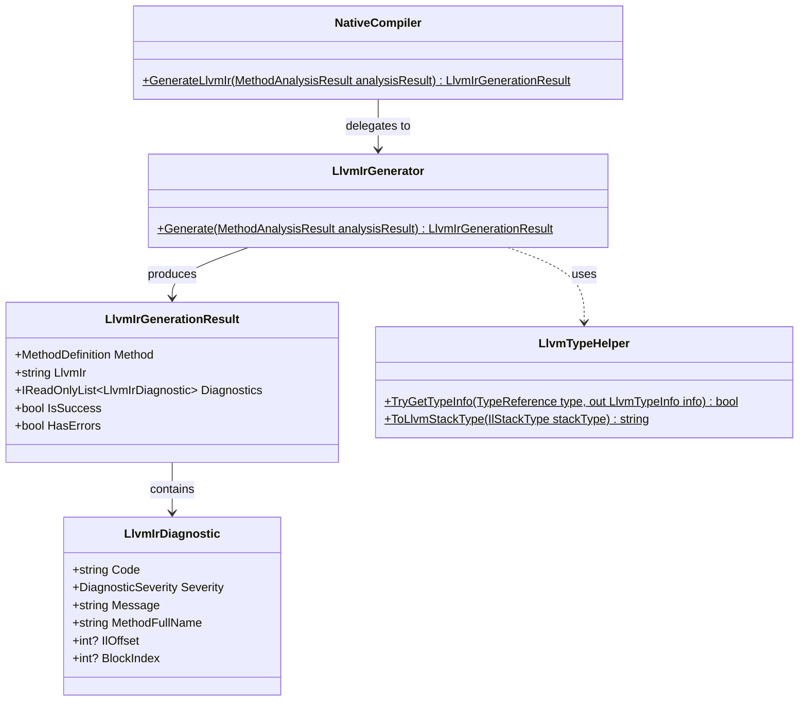

# Compiler Subsystem: LLVM IR Generation

The LLVM IR Generation subsystem constitutes **Milestone 4** of Axiom.Native. It consumes successfully verified methods from [IL Analysis](il-analysis.md) and translates their control-flow graphs (CFG) and evaluation stack operations into valid, verifiable LLVM Intermediate Representation (IR).

---

## 1. Subsystem Architecture & Contracts

The generator resides in `Axiom.Native.Compiler` under the namespace `Axiom.Native`:



### Input & Output Contracts
- **Input**: [`MethodAnalysisResult`](file:///d:/Projects/Axiom/Native/projects/Axiom.Native.Compiler/sources/Analysis/MethodAnalysisResult.cs)
  - Must have `IsSupported == true` and `HasErrors == false`.
  - Must contain a valid [`IlControlFlowGraph`](file:///d:/Projects/Axiom/Native/projects/Axiom.Native.Compiler/sources/Analysis/IlControlFlowGraph.cs) with basic blocks and simulated evaluation stack heights.
- **Output**: [`LlvmIrGenerationResult`](file:///d:/Projects/Axiom/Native/projects/Axiom.Native.Compiler/sources/CodeGeneration/LlvmIrGenerationResult.cs)
  - `IsSuccess`: `true` if IR generation completed without errors and produced valid textual LLVM IR.
  - `LlvmIr`: The textual LLVM IR string (or `null` on failure).
  - `Diagnostics`: Collection of structured [`LlvmIrDiagnostic`](file:///d:/Projects/Axiom/Native/projects/Axiom.Native.Compiler/sources/CodeGeneration/LlvmIrDiagnostic.cs) items (`AXM3001`–`AXM3008`).

---

## 2. Type Mapping: CLR to LLVM

LLVM integer types do not carry signedness in their type identifiers (`i1`, `i8`, `i16`, `i32`, `i64`). The signedness of an operation is determined by the selected LLVM opcode (e.g. `sdiv` vs `udiv`, `sext` vs `zext`, `ashr` vs `lshr`).

[`LlvmTypeHelper`](file:///d:/Projects/Axiom/Native/projects/Axiom.Native.Compiler/sources/CodeGeneration/LlvmTypeHelper.cs) maps CLR primitive types according to the table below:

| CLR Primitive | Metadata Type | LLVM Type | Bit Width | Signedness | Alignment | Stack Representation |
|---|---|:---:|:---:|:---:|:---:|:---:|
| `System.Boolean` | `Boolean` | `i1` | 1 | Unsigned | 1 | Extended to `i32` (`zext`) |
| `System.Byte` | `Byte` | `i8` | 8 | Unsigned | 1 | Extended to `i32` (`zext`) |
| `System.SByte` | `SByte` | `i8` | 8 | Signed | 1 | Extended to `i32` (`sext`) |
| `System.Int16` | `Int16` | `i16` | 16 | Signed | 2 | Extended to `i32` (`sext`) |
| `System.UInt16` | `UInt16` | `i16` | 16 | Unsigned | 2 | Extended to `i32` (`zext`) |
| `System.Char` | `Char` | `i16` | 16 | Unsigned | 2 | Extended to `i32` (`zext`) |
| `System.Int32` | `Int32` | `i32` | 32 | Signed | 4 | `i32` |
| `System.UInt32` | `UInt32` | `i32` | 32 | Unsigned | 4 | `i32` |
| `System.Int64` | `Int64` | `i64` | 64 | Signed | 8 | `i64` |
| `System.UInt64` | `UInt64` | `i64` | 64 | Unsigned | 8 | `i64` |
| `System.Void` | `Void` | `void` | 0 | N/A | 0 | N/A |

---

## 3. Translation Strategy: Stack, Locals & Control Flow

### A. Dedicated Function Entry & Local Variables
In LLVM IR, the function entry block cannot have predecessors and cannot contain `phi` nodes. Axiom.Native emits a dedicated `entry:` prologue block:
1. Allocates stack slots for all declared method local variables using `alloca` with appropriate type alignment.
2. Zero-initializes each local variable (`store <type> 0, ptr %loc_i, align <align>`).
3. Emits an unconditional branch `br label %block_0` to the CFG's first basic block.

This canonical `entry` layout guarantees that:
- Local variables are allocated once upon function entry without being reallocated in loops.
- Standard LLVM optimization passes (`mem2reg`) cleanly convert all local `alloca` slots into SSA register form and phi nodes.

### B. Evaluation Stack & Intra-Block SSA
Inside each basic block, the CLR evaluation stack is mapped to virtual SSA values (`%v0`, `%v1`, `%v2`, ...):
- **Constants** (`ldc.i4.*`, `ldc.i8`) are pushed directly as typed literals (e.g. `42`, `-1`).
- **Arithmetic operations** pop operand values from the block's current stack and emit an LLVM instruction producing a new SSA register.
- **`dup`** duplicates the top operand reference.
- **`pop`** discards the top operand without emitting machine code.

### C. Block Merges & `phi` Nodes
When control flow converges at a basic block $B$ where `B.EntryStack.Count > 0`:
1. For each stack position $k \in [0, K-1]$, a `phi` instruction is emitted at the top of block $B$:
   ```llvm
   %phi_B_k = phi i32 [ %val_pred1, %block_pred1 ], [ %val_pred2, %block_pred2 ]
   ```
2. The operands for the `phi` node are gathered directly from the exit stacks of each reachable predecessor block.
3. The resulting `%phi_B_k` register is pushed onto $B$'s working stack before block instructions are lowered.

### D. Terminator Enforcement
In CIL, basic blocks may end with instructions that fall through sequentially into the next block. In contrast, LLVM IR strictly requires that **every basic block end with a terminator instruction** (`ret`, `br`, or conditional `br`).

If an analyzed basic block does not end with an explicit branch or return, [`LlvmIrGenerator`](file:///d:/Projects/Axiom/Native/projects/Axiom.Native.Compiler/sources/CodeGeneration/LlvmIrGenerator.cs) automatically synthesizes an unconditional jump to the sequential fallthrough block:
```llvm
br label %block_{nextBlock.Index}
```

---

## 4. Supported Instruction Lowering Table

| Category | CIL Instruction(s) | LLVM IR Translation |
|---|---|---|
| **Constants** | `ldc.i4.m1` .. `ldc.i4.8`<br/>`ldc.i4.s`, `ldc.i4`<br/>`ldc.i8` | Pushes typed literal operand (`"i32"`, `"-1"`, `"42"` / `"i64"`, `"1000"`). |
| **Arguments** | `ldarg.0` .. `ldarg.3`<br/>`ldarg.s`, `ldarg` | Uses `%arg_i`. If parameter bit-width $< 32$, widens with `sext` (signed) or `zext` (unsigned) to `i32`. |
| **Locals** | `ldloc.0` .. `ldloc.3`<br/>`ldloc.s`, `ldloc`<br/>`stloc.0` .. `stloc.3`<br/>`stloc.s`, `stloc` | `ldloc`: `load` from `%loc_i`, widen if $< 32$.<br/>`stloc`: truncate if target $< 32$, `store` to `%loc_i`. |
| **Stack Ops** | `dup`, `pop` | Symbolic stack manipulation (no instructions emitted). |
| **Arithmetic** | `add`<br/>`sub`<br/>`mul`<br/>`div`<br/>`div.un`<br/>`rem`<br/>`rem.un`<br/>`neg` | `add <ty> %a, %b`<br/>`sub <ty> %a, %b`<br/>`mul <ty> %a, %b`<br/>`sdiv <ty> %a, %b` (signed division)<br/>`udiv <ty> %a, %b` (unsigned division)<br/>`srem <ty> %a, %b` (signed remainder)<br/>`urem <ty> %a, %b` (unsigned remainder)<br/>`sub <ty> 0, %a` (negation) |
| **Bitwise** | `and`, `or`, `xor`<br/>`not` | `and <ty> %a, %b`, `or <ty> %a, %b`, `xor <ty> %a, %b`<br/>`xor <ty> %a, -1` (bitwise NOT) |
| **Shifts** | `shl`<br/>`shr`<br/>`shr.un` | Masks shift amount (`and i32 %s, 31` or `and i64 %s, 63`):<br/>`shl <ty> %a, %masked`<br/>`ashr <ty> %a, %masked` (arithmetic/signed)<br/>`lshr <ty> %a, %masked` (logical/unsigned) |
| **Conversions** | `conv.i4`, `conv.u4`<br/>`conv.i8`<br/>`conv.u8` | `trunc i64 %a to i32` (if narrowing from `i64`)<br/>`sext i32 %a to i64` (signed widening)<br/>`zext i32 %a to i64` (unsigned widening) |
| **Comparisons** | `ceq`<br/>`cgt`<br/>`cgt.un`<br/>`clt`<br/>`clt.un` | `icmp eq <ty> %a, %b`<br/>`icmp sgt <ty> %a, %b`<br/>`icmp ugt <ty> %a, %b`<br/>`icmp slt <ty> %a, %b`<br/>`icmp ult <ty> %a, %b`<br/>Result is zero-extended (`zext i1 to i32`). |
| **Branches** | `br`, `br.s`<br/>`brtrue`, `brtrue.s`<br/>`brfalse`, `brfalse.s`<br/>`beq` .. `blt.un` | Unconditional: `br label %block_target`<br/>Unary: `icmp ne/eq %val, 0` $\to$ `br i1 %c, label %target, label %fallthrough`<br/>Binary: `icmp <pred> %a, %b` $\to$ `br i1 %c, label %target, label %fallthrough` |
| **Returns** | `ret` | `ret void` (void methods)<br/>`ret <type> %val` (matching return)<br/>`trunc i32 %val to <ret_ty>` $\to$ `ret <ret_ty>` (sub-word return). |

---

## 5. Verification Strategy

Generated LLVM IR is verified through two distinct layers:
1. **Structural Invariant Asserts (Unit Tests)**:
   Asserts valid function signature, valid entry block, correct block terminator structure, and absence of unresolved variables.
2. **LLVM Toolchain Verifier (`opt -passes=verify`)**:
   When an LLVM toolchain (such as LLVM 18.1.8) is available in the environment (`opt.exe` in PATH or tool directories), test execution pipes the generated IR directly through `opt -passes=verify`. All generated IR must exit with code `0`.

---

## 6. Real Code Generation Example

Given the C# method:
```csharp
[NativeCompile]
public static int SumLoop(int n)
{
    int sum = 0;
    for (int i = 0; i < n; i++)
    {
        sum += i;
    }
    return sum;
}
```

[`LlvmIrGenerator`](file:///d:/Projects/Axiom/Native/projects/Axiom.Native.Compiler/sources/CodeGeneration/LlvmIrGenerator.cs) emits:
```llvm
; ModuleID = 'Axiom.Native'
source_filename = "Axiom.Native"

define i32 @"System.Int32 Axiom.Native.Compiler.Tests.TestAssembly.IlAnalysisPositiveSamples::SumLoop(System.Int32)"(i32 %arg_0) {
entry:
  %loc_0 = alloca i32, align 4
  store i32 0, ptr %loc_0, align 4
  %loc_1 = alloca i32, align 4
  store i32 0, ptr %loc_1, align 4
  %loc_2 = alloca i1, align 1
  store i1 0, ptr %loc_2, align 1
  br label %block_0

block_0:
  store i32 0, ptr %loc_0, align 4
  store i32 0, ptr %loc_1, align 4
  br label %block_2

block_1:
  %v0 = load i32, ptr %loc_0, align 4
  %v1 = load i32, ptr %loc_1, align 4
  %v2 = add i32 %v0, %v1
  store i32 %v2, ptr %loc_0, align 4
  %v3 = load i32, ptr %loc_1, align 4
  %v4 = add i32 %v3, 1
  store i32 %v4, ptr %loc_1, align 4
  br label %block_2

block_2:
  %v5 = load i32, ptr %loc_1, align 4
  %v6 = icmp slt i32 %v5, %arg_0
  br i1 %v6, label %block_1, label %block_3

block_3:
  %v7 = load i32, ptr %loc_0, align 4
  ret i32 %v7
}
```
*(Verified by `opt -passes=verify` with 0 errors).*

