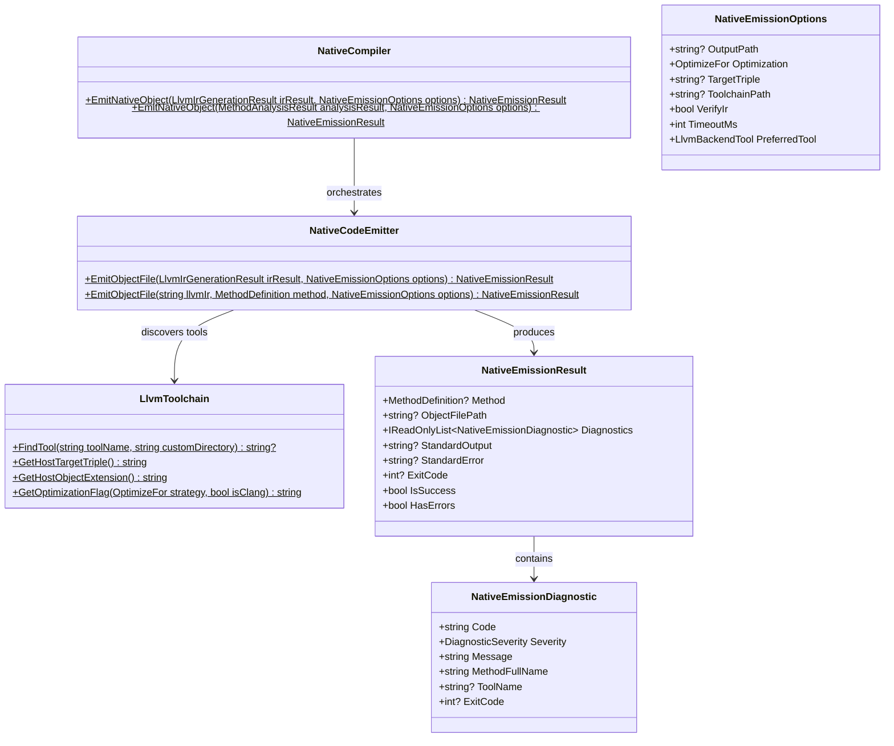

# Compiler Subsystem: Native Code Emission

The Native Code Emission subsystem constitutes **Milestone 5** of Axiom.Native. It accepts verified LLVM Intermediate Representation (IR) from the [LLVM IR Generation](llvm-ir-generation.md) subsystem and compiles it into a native machine object file (`.obj` on Windows COFF, `.o` on Unix/Linux ELF and macOS Mach-O) targeting the current host architecture.

---

## 1. Subsystem Architecture & Contracts

The subsystem resides in `Axiom.Native.Compiler` under the namespace `Axiom.Native`:



### Input & Output Contracts
- **Input**:
  - [`LlvmIrGenerationResult`](file:///d:/Projects/Axiom/Native/projects/Axiom.Native.Compiler/sources/CodeGeneration/LlvmIrGenerationResult.cs) (from Milestone 4) or valid textual LLVM IR string.
  - [`NativeEmissionOptions`](file:///d:/Projects/Axiom/Native/projects/Axiom.Native.Compiler/sources/CodeGeneration/NativeEmissionOptions.cs) configuring output path, optimization strategy, target triple, and toolchain location.
- **Output**:
  - [`NativeEmissionResult`](file:///d:/Projects/Axiom/Native/projects/Axiom.Native.Compiler/sources/CodeGeneration/NativeEmissionResult.cs):
    - `IsSuccess`: `true` only when compiler backend exits with code `0` and the output object file exists and has non-zero size.
    - `ObjectFilePath`: Absolute path to the emitted machine object file.
    - `StandardOutput` and `StandardError`: Captured process output streams.
    - `Diagnostics`: Collection of structured [`NativeEmissionDiagnostic`](file:///d:/Projects/Axiom/Native/projects/Axiom.Native.Compiler/sources/CodeGeneration/NativeEmissionDiagnostic.cs) items (`AXM4001`–`AXM4008`).

---

## 2. Toolchain Discovery & Configuration

Axiom.Native avoids hardcoded machine paths. Tool discovery in [`LlvmToolchain`](file:///d:/Projects/Axiom/Native/projects/Axiom.Native.Compiler/sources/CodeGeneration/LlvmToolchain.cs) searches in priority order:

1. **Explicit Custom Directory**: If `options.ToolchainPath` is provided, the tool is searched strictly within that directory. If missing, lookups do not silently fall back to random binaries.
2. **Environment Variables**: Searches directories specified in:
   - `AXIOM_LLVM_PATH`
   - `AXIOM_LLVM_BIN`
   - `LLVM_HOME`
   - `LLVM_PATH`
   (both direct path and `bin/` subfolder).
3. **System `PATH`**: Searches all segments in the host operating system's `PATH` variable.
4. **Standard System Locations**:
   - Windows: `%ProgramFiles%\LLVM\bin`
   - Linux / macOS: `/usr/bin`, `/usr/local/bin`, `/opt/homebrew/bin`

### Supported Backend Compilers
The emitter discovers either:
- **`clang`**: LLVM C compiler driver (invoked via `clang -c <input.ll> -o <output.obj> <opt> [-target <triple>]`).
- **`llc`**: LLVM Static Compiler (invoked via `llc -filetype=obj <input.ll> -o <output.obj> <opt> [-mtriple=<triple>]`).

By default (`PreferredTool = LlvmBackendTool.Auto`), the emitter prefers `clang` if present and falls back to `llc`. Callers can force `Llc` or `Clang` via options.

---

## 3. Host Target Architecture & Object Format

The subsystem targets the host machine executing the compiler:

| Operating System | Process Architecture | Host Target Triple | Object Extension | Binary Format |
|---|---|---|:---:|---|
| **Windows** | `X64` | `x86_64-pc-windows-msvc` | `.obj` | PE / COFF |
| **Windows** | `Arm64` | `aarch64-pc-windows-msvc` | `.obj` | PE / COFF |
| **Linux** | `X64` | `x86_64-unknown-linux-gnu` | `.o` | ELF |
| **Linux** | `Arm64` | `aarch64-unknown-linux-gnu` | `.o` | ELF |
| **macOS** | `Arm64` | `aarch64-apple-darwin` | `.o` | Mach-O |
| **macOS** | `X64` | `x86_64-apple-darwin` | `.o` | Mach-O |

Target triples are detected dynamically via [`LlvmToolchain.GetHostTargetTriple()`](file:///d:/Projects/Axiom/Native/projects/Axiom.Native.Compiler/sources/CodeGeneration/LlvmToolchain.cs) using `RuntimeInformation.ProcessArchitecture` and OS platform checks, avoiding heuristic string parsing.

---

## 4. Optimization Strategy Mapping

The [`OptimizeFor`](file:///d:/Projects/Axiom/Native/projects/Axiom.Native.Abstractions/sources/OptimizeFor.cs) mode requested on compilation roots is mapped directly to compiler backend optimization flags:

| `OptimizeFor` Mode | `clang` Flag | `llc` Flag | Optimization Objectives |
|---|:---:|:---:|---|
| **`Debug`** | `-O0` | `-O0` | Disables optimization passes, preserving debug symbol hooks and original instruction structure. |
| **`ExecutionSpeed`** | `-O3` | `-O3` | Enables aggressive vectorization, loop unrolling, and maximum throughput optimization passes. |
| **`BuildSize`** | `-Oz` | `-O2` | Prioritizes minimal native machine code footprint (`-Oz` in clang, `-O2` in llc). |

---

## 5. Verification & Compilation Lifecycle

The emission pipeline executes the following stages:

```mermaid
sequenceDiagram
    autonumber
    participant Caller
    participant Emitter as NativeCodeEmitter
    participant Toolchain as LlvmToolchain
    participant Opt as opt (Verifier)
    participant Backend as clang / llc (Backend)

    Caller->>Emitter: EmitObjectFile(irResult, options)
    Emitter->>Emitter: Validate IR (reject if null or failed)

    opt If options.VerifyIr is true and opt found
        Emitter->>Opt: opt -passes=verify temp.ll -o NUL
        Opt-->>Emitter: Exit code & stderr
        Emitter->>Emitter: Fail with AXM4002 if exit code != 0
    end

    Emitter->>Toolchain: ResolveBackendTool(options)
    Toolchain-->>Emitter: Tool path (clang or llc)

    Emitter->>Emitter: Write temp.ll file
    Emitter->>Backend: clang/llc -c temp.ll -o target.obj [flags]
    Backend-->>Emitter: Exit code, stdout, stderr

    Emitter->>Emitter: Delete temp.ll
    Emitter->>Emitter: Validate target.obj exists and is non-empty
    Emitter-->>Caller: NativeEmissionResult (IsSuccess, ObjectFilePath, Diagnostics)
```

1. **Pre-Emission Verification**: If `options.VerifyIr` is enabled and `opt` is available, the IR is verified prior to compilation. Verification failures emit `AXM4002` immediately.
2. **Safe Process Execution**: Executables are launched with structured `ArgumentList` arguments (no shell concatenation), with stdout and stderr asynchronously drained to prevent buffer deadlocks.
3. **Temporary File Management**: Source `.ll` files are written to unique temp paths and guaranteed to be deleted in a `finally` block upon completion or failure.
4. **Physical Artifact Verification**: Success is never reported unless the output file actually exists on disk and has a non-zero byte count (`FileInfo.Length > 0`).

---

## 6. Usage Example

```csharp
using Axiom.Native;

// 1. Run discovery and IL analysis
var discovery = NativeAssemblyLoader.DiscoverRoots(context);
var root = discovery.Methods[0];
var analysis = MethodIlAnalyzer.Analyze(root.Definition);

// 2. Generate LLVM IR
var irResult = NativeCompiler.GenerateLlvmIr(analysis);

// 3. Emit native object file
var options = new NativeEmissionOptions
{
    OutputPath = @"artifacts/kernels/FastMath.obj",
    Optimization = OptimizeFor.ExecutionSpeed
};

var emissionResult = NativeCompiler.EmitNativeObject(irResult, options);

if (emissionResult.IsSuccess)
{
    Console.WriteLine($"Compiled native object: {emissionResult.ObjectFilePath}");
    Console.WriteLine($"File size: {new FileInfo(emissionResult.ObjectFilePath!).Length} bytes");
}
else
{
    Console.WriteLine("Emission failed:");
    foreach (var diag in emissionResult.Diagnostics)
    {
        Console.WriteLine($" - [{diag.Code}] {diag.Message}");
    }
}
```

---

## 7. Known Boundaries & Non-Goals

- **Object Files Only**: This milestone produces compiled native object files (`.obj` / `.o`). Dynamic link library creation (`.dll` / `.so`), symbol table export definitions, and executable linking belong to downstream milestones.
- **No Runtime Dispatch**: Generated object files are standalone binary artifacts; runtime loading and invocation belong to `Axiom.Native.Runtime`.

