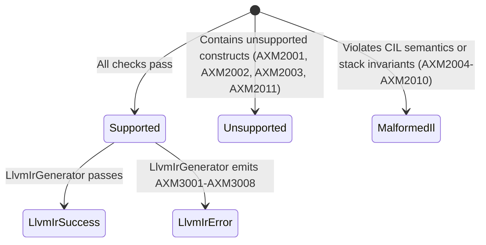

# Axiom.Native Diagnostics Reference

Axiom.Native uses structured, deterministic diagnostic error codes to communicate precisely why a method or assembly cannot be compiled to native code.

Diagnostics are partitioned by subsystem:
- **`AXM1001`–`AXM1007`**: Emitted during Dependency Resolution ([Milestone 2](compiler/dependencies.md)).
- **`AXM2001`–`AXM2011`**: Emitted during IL Analysis & Stack Simulation ([Milestone 3](compiler/il-analysis.md)).
- **`AXM3001`–`AXM3008`**: Emitted during LLVM IR Generation ([Milestone 4](compiler/llvm-ir-generation.md)).

---

## 1. Dependency Resolution Diagnostics (`AXM1001`–`AXM1007`)

| Code | Severity | Description | Typical Cause | Recommended Action |
|---|:---:|---|---|---|
| **`AXM1001`** | Error | Failed to resolve metadata reference. | An external method or type reference cannot be located in referenced assemblies. | Verify that all dependency assemblies are available in the search path of the assembly resolver. |
| **`AXM1002`** | Terminal Unsupported | Target method is abstract. | An abstract method was invoked directly via `call`. | Ensure calls target concrete method implementations rather than abstract member definitions. |
| **`AXM1003`** | Terminal Unsupported | Target method is P/Invoke (`DllImport`). | The method delegates directly to an unmanaged library export. | P/Invoke methods are already native; avoid compiling them via Axiom.Native or isolate them from kernel logic. |
| **`AXM1004`** | Terminal Unsupported | Target method is runtime `InternalCall`. | The method is implemented internally by the CLR execution engine (e.g., core runtime intrinsics). | Replace the call with an equivalent primitive algorithm or supported library method. |
| **`AXM1005`** | Terminal Unsupported | Target method has no IL body. | An extern or runtime-generated method lacks a CIL method body. | Provide an explicit managed method implementation. |
| **`AXM1006`** | Terminal Unsupported | Generic method or type invocation is unsupported. | Target method is generic (e.g., `Add<T>(T a, T b)`) or declared inside an open generic type. | Monomorphize the method manually using concrete primitive types (e.g., `AddInt32`). |
| **`AXM1007`** | Terminal Unsupported | Interface or virtual call requires runtime dynamic dispatch. | The target method is called via `callvirt` on an interface or unsealed virtual class. | Devirtualize the call or seal the target class/method so calls resolve statically. |

---

## 2. IL Analysis Diagnostics (`AXM2001`–`AXM2011`)

| Code | Severity | Description | Typical Cause | Recommended Action |
|---|:---:|---|---|---|
| **`AXM2001`** | Unsupported | Instruction is outside the supported IL subset. | Use of unmanaged pointer ops, allocations (`newarr`, `newobj`), heap loads, or `starg`. | Restructure method to use only local primitive variables, stack operations, and integer arithmetic. |
| **`AXM2002`** | Unsupported | Unsupported type in signature, locals, or `this` access. | Use of reference types (`string`, classes), arrays, floating-point (`float`, `double`), or accessing `this`. | Use static methods operating strictly on supported integer/boolean primitive types (`int`, `long`, `uint`, `ulong`, `byte`, `bool`). |
| **`AXM2003`** | Unsupported | Method contains exception handling clauses. | Method contains `try`, `catch`, `finally`, or `fault` blocks. | Avoid exception handlers in native computational kernels; return status codes instead. |
| **`AXM2004`** | Malformed IL | Evaluation stack underflow. | An instruction attempted to pop an operand from an empty evaluation stack. | Verify IL validity. (Compiler bug or corrupted bytecode). |
| **`AXM2005`** | Malformed IL | Incompatible operand types on evaluation stack. | Binary operator attempted to combine mismatched types (e.g., `I4` and `I8`). | Insert explicit conversion (`conv.i8` or `conv.i4`) to align operand types. |
| **`AXM2006`** | Malformed IL | Stack height or type mismatch at control flow merge point. | Two branch paths leading into the same basic block have differing stack heights or clashing types. | Ensure all incoming branch paths leave the evaluation stack with identical height and matching types. |
| **`AXM2007`** | Malformed IL | Branch target is outside method boundaries. | Branch instruction points to an invalid instruction offset. | Verify that branch targets point to valid instruction offsets inside the method body. |
| **`AXM2008`** | Malformed IL | Invalid return stack state. | `ret` executed with non-empty stack in a `void` method, or wrong operand type in a value-returning method. | Ensure the stack has exactly one item matching the return type, or is completely empty for `void`. |
| **`AXM2009`** | Malformed IL | Invalid instruction operand (out of bounds). | `ldarg` or `ldloc` index exceeds the count of declared parameters or local variables. | Check parameter and local variable declarations for valid index bounds. |
| **`AXM2010`** | Malformed IL | Invalid control flow or missing method body. | Method definition has no IL body or execution falls off the end of a basic block without a branch/return. | Ensure all execution paths terminate with an explicit branch or `ret`. |
| **`AXM2011`** | Unsupported | Method invocation inside IL analysis is unsupported. | Direct or virtual invocation (`call`, `callvirt`) encountered during IL analysis. | Inline helper calculations or wait for call translation support in future compiler stages. |

---

## 3. LLVM IR Generation Diagnostics (`AXM3001`–`AXM3008`)

| Code | Severity | Description | Typical Cause | Recommended Action |
|---|:---:|---|---|---|
| **`AXM3001`** | Error | Method analysis result is not supported or contains errors. | Invoking `LlvmIrGenerator` on a method that failed IL Analysis or has unresolved metadata. | Ensure method passes `MethodIlAnalyzer.Analyze` before generating LLVM IR. |
| **`AXM3002`** | Error | Method has no CFG or CFG has no basic blocks. | `MethodAnalysisResult.Cfg` is null or contains zero basic blocks. | Verify that the method has a non-empty IL body that produces a valid control-flow graph. |
| **`AXM3003`** | Error | Unsupported type in signature or local variables. | Method uses complex types, reference types, or pointers not mappable to LLVM primitives. | Restrict types to supported integer and boolean primitives (`i1`, `i8`, `i16`, `i32`, `i64`). |
| **`AXM3004`** | Error | Unsupported instruction during IR generation. | Encountered unhandled opcode or `this` pointer access during lowering. | Restrict methods to the supported primitive IL instruction subset. |
| **`AXM3005`** | Error | Stack underflow or type mismatch during instruction lowering. | An instruction attempted to pop an operand from an empty stack during LLVM emission. | Compiler invariant failure; ensure IL Analysis passed without warnings. |
| **`AXM3006`** | Error | Branch target cannot be resolved to a basic block. | Branch instruction points to an invalid instruction offset not matching any basic block start. | Verify CFG block boundaries and branch operands. |
| **`AXM3007`** | Error | Predecessor stack value mismatch when building phi node. | Predecessor basic block exit stack does not contain an operand for an incoming phi slot. | Invariant violation; ensure all predecessor branches leave consistent stack heights. |
| **`AXM3008`** | Error | Internal error during LLVM IR generation. | An unexpected exception occurred inside `LlvmIrGenerator.GenerateCore`. | Inspect exception message and method definition for abnormal bytecode structure. |

---

## 4. Diagnostic Severity and Support Hierarchy

When a method is analyzed, the diagnostics dictate the resulting status:

- **`AXM3001`–`AXM3008`** prevent LLVM IR output (`LlvmIrGenerationResult.IsSuccess == false`, `LlvmIr == null`).
- Generation is deterministic and non-throwing; all expected failures produce structured diagnostic objects.
