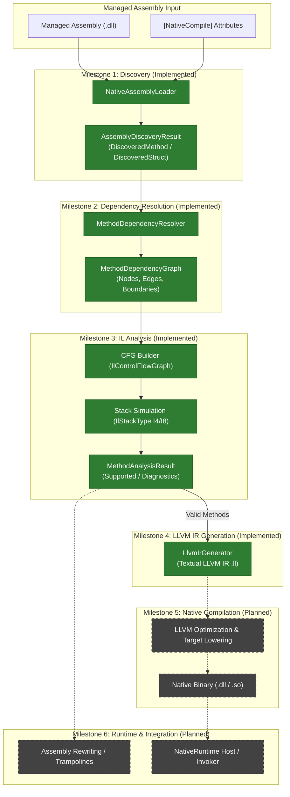

# Axiom.Native Overview

## 1. Problem Statement & Motivation

In high-performance .NET computing, certain algorithms—such as matrix math, DSP kernels, cryptography primitives, physics loops, and tight numerical routines—require machine-level optimization (vectorization, loop unrolling, register allocation) exceeding what the standard JIT can provide in predictable time budgets.

While .NET offers Native AOT, it compiles entire applications and preserves the full managed runtime environment (GC, runtime types, unwinding). **Axiom.Native** takes an alternative approach:
- Target **individual methods** or small computational clusters annotated with `[NativeCompile]`.
- Enforce strict static analysis to ensure memory and type safety within a restricted primitive subset.
- Lower high-frequency computational loops to native machine code using the **LLVM** compiler framework.
- Eliminate managed runtime overhead (boxing, GC tracking, virtual dispatch) within native computational kernels.

---

## 2. Core Philosophy & Design Principles

1. **No Silent Fallback**: If an annotated method or any required dependency cannot be safely analyzed or compiled, compilation **must fail deterministically** with actionable diagnostic errors. Axiom.Native never falls back to managed execution silently.
2. **Explicit Metadata Attribution**: Compilation roots are explicitly selected by developers using `[NativeCompile]`, avoiding whole-program analysis overhead.
3. **Decoupled Architecture**:
   - [`Axiom.Native.Abstractions`](file:///d:/Projects/Axiom/Native/projects/Axiom.Native.Abstractions): Lightweight, zero-dependency contract assembly.
   - [`Axiom.Native.Compiler`](file:///d:/Projects/Axiom/Native/projects/Axiom.Native.Compiler): Static analysis, IL inspection, and LLVM IR generation. Relies on `Mono.Cecil`.
   - [`Axiom.Native.Runtime`](file:///d:/Projects/Axiom/Native/projects/Axiom.Native.Runtime): Isolated runtime execution host. Never references LLVM or the Compiler.
4. **Deterministic and Actionable Diagnostics**: Every rejection emits a specific diagnostic code (e.g., `AXM1001`–`AXM1007`, `AXM2001`–`AXM2011`, `AXM3001`–`AXM3008`) identifying the exact reason, target instruction offset, and member signature.

---

## 3. End-to-End Pipeline Workflow

The compilation pipeline moves from managed assembly ingestion down to native execution. The diagram below illustrates the complete architectural pipeline, highlighting the **implemented front-end & IR generation** and the **planned native back-end**:

---

## 4. Current State & Supported Scope

### Implemented Subsystems
- **Managed Assembly Inspection**: Inspect assemblies from disk or memory streams via Mono.Cecil without locking physical files (`ReadingMode.Immediate`).
- **Compilation Root Discovery**: Discover annotated static and instance methods, value types (structs), and nested types. Respect method-level optimization overrides.
- **Transitive Dependency Resolution**: Traverse call graphs, detect cycles, deduplicate nodes, validate `call` vs `callvirt`, and identify foreign or BCL terminal boundaries.
- **Control Flow Graph Construction**: Partition IL instructions into basic blocks delimited by branch instructions and branch targets.
- **Typed Stack Simulation**: Simulate CLR evaluation stack state using a fixpoint worklist algorithm. Validate stack height convergence, branch targets, and operand type compatibility (`I4` and `I8`).
- **LLVM IR Generation**: Translate validated CFGs and evaluation stack states into verified textual LLVM IR, featuring entry block local variable `alloca` layout, evaluation stack SSA lowering, `phi` node merge reconciliation, masked shift amounts, and signed/unsigned opcode selection.

### Planned Subsystems
- **Native Binary Compilation**: LLVM execution, target machine codegen, and shared library compilation (`.dll`, `.so`, `.dylib`).
- **Managed Body Rewriting**: Replacing managed method IL with native entry points or P/Invoke stubs.
- **Native Runtime Host**: Runtime loading, validation, and invoking of compiled native code (`NativeRuntime.cs` is currently an empty placeholder).

---

## 5. Next Steps

To explore specific subsystems in depth:
- Read [Architecture & Design](architecture.md) for module decomposition and lifetime rules.
- Review [Public API](public-api.md) for metadata annotations.
- Review [IL Analysis Subsystem](compiler/il-analysis.md) for stack typing and opcode support.
- Review [LLVM IR Generation Subsystem](compiler/llvm-ir-generation.md) for IR lowering details.
- Review [Diagnostics Reference](diagnostics.md) for compiler error codes.
